<div align="center">

# 🏢 Enterprise ERP & GST Management Suite

**A full-stack, GST-compliant ERP with an X3M (Material 3) UI — Procurement, Sales & Billing, CRM Kanban, Multi-Project Cost Mapping, Inventory, and GST Portal reconciliation.**


</div>

---

## 📖 Overview

A unified business management platform styled after the **X3M Admin Dashboard**. It streamlines both **buyer (procurement)** and **seller (sales)** operations, automates **Indian GST** tax management, supports **multi-project tracking**, enables **drag-and-drop CRM lead tracking**, and maintains **inventory** with **role-based access control**.

Built as a lightweight REST API (Express) + a dependency-free vanilla-JS single-page app, served from one process — so it runs anywhere Node runs, with no frontend build step.

---

## ✨ Features

### 🔐 Authentication & Role-Based Access Control (RBAC)
- Secure session login with **default `admin` / `admin`** and **mandatory first-login password reset**
- Staff account creation with **custom roles** and **granular per-module permissions** (Create / Read / Update / Delete / Export / Approve)
- Full **audit trail** — timestamp, user, IP, action, and resource for every event
- Split-secret **password hashing** (bcrypt)
- Module visibility enforced in UI sidebar **and** on the API

### 📦 Procurement & Multi-Vendor Management
- **Vendor Directory** with GSTIN, PAN, bank details, payment terms, and HSN/SAC codes
- **Multi-vendor quote comparison matrix** — side-by-side price, GST, lead time, and payment terms with automatic **"Lowest"** highlighting
- Single-click **RFQ → Purchase Order** conversion
- Auto-numbered POs and **shipment tracking** (Ordered → Shipped → In-Transit → Delivered)
- **GRN / Goods Receipt** that pushes stock **IN**
- **Warranty & serial-number register** with 30-day expiry alerts

### 🧾 Sales, Outward Invoicing & Logistics
- **Customer Directory** with GSTIN, Place of Supply, and address
- Full document pipeline: **Proforma Invoices, GST Tax Invoices, Delivery Receipts/Challans, Credit Notes, Debit Notes**
- Automatic **CGST + SGST (intra-state)** vs **IGST (inter-state)** determination from Place of Supply
- **E-Way Bill JSON** generation (Rule 138 compliant format)
- Outward shipment tracking with carrier / AWB numbers
- **Payment Receipts** and **30 / 60 / 90-day receivables aging** report
- Auto stock **OUT** on invoice/challan dispatch

### 🎛️ CRM Lead Tracking (Trello-style Kanban)
- Drag-and-drop **Kanban board** across custom pipeline stages (*New, Contacted, Requirement Gathering, Proposal Sent, Won, Lost*)
- Convert a **"Won"** lead directly into a **client customer + GST invoice**

### 📂 Multi-Project Management & Cost Mapping
- Link outward invoices, vendor POs, expenses, and receipts to specific projects
- Real-time profitability:
  `Net Project Profit = Mapped Sales Invoices − (Mapped Vendor Bills + Direct Expenses)`
- Budget vs. margin visualisation

### 📊 Real-time Inventory Management
- **Item Master** with SKU, **barcode/QR**, UOM, and default HSN/SAC
- **Multi-warehouse** stock levels
- **Automatic stock synchronization** — deductions on Delivery Challans / Tax Invoices, additions on GRN
- **Low-stock / reorder** alerts and complete **stock movement log**

### 🏛️ GST Portal Integration & Reconciliation
- **GSTR-2B import** (GSP/ASP pull simulation) and automated **reconciliation** against ERP vendor bills
- Flags **Matched / Tax Mismatch / Missing in ERP / Missing in Portal**
- **GSTR-1** and **GSTR-3B JSON export** auto-computed from issued invoices
- **Direct filing** action with **EVC** acknowledgement
- Return filing history with reference (ACK) numbers and GST portal connection status

### 🎨 UI/UX
- **Dual navigation** — global top bar (search, quick-create, notifications, GST status, user switcher) + expandable left drawer
- X3M Material 3 aesthetic — off-white `#F8F9FA` background, `#1A73E8` blue accents, borderless tables, subtle badges
- **Fully responsive** — desktop, tablet, and mobile (off-canvas drawer, fluid grids, scrollable tables)
- In-app **notifications**, **global instant search** (invoices, POs, GSTINs, SKUs, projects)

---

## 📸 Screenshots

### Authentication
| Login |
|---|
| 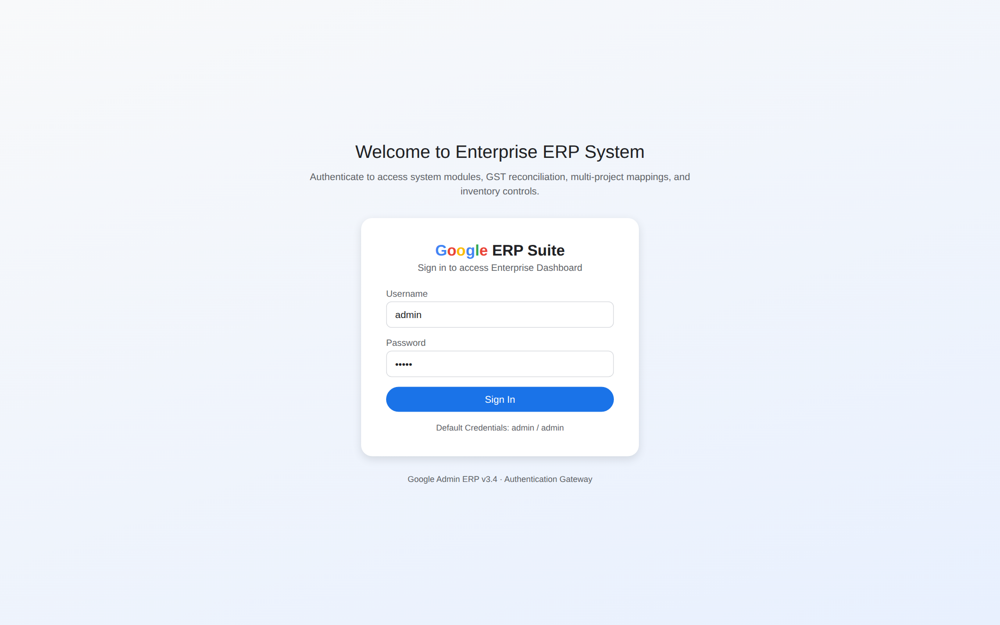 |

### Dashboard
| Enterprise Overview |
|---|
| 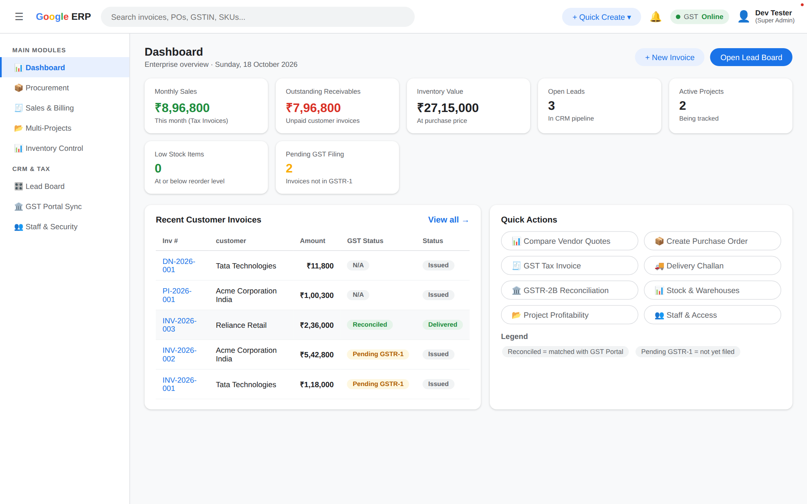 |

### 📦 Procurement
| Multi-Vendor Quote Comparison Matrix |
|---|
| 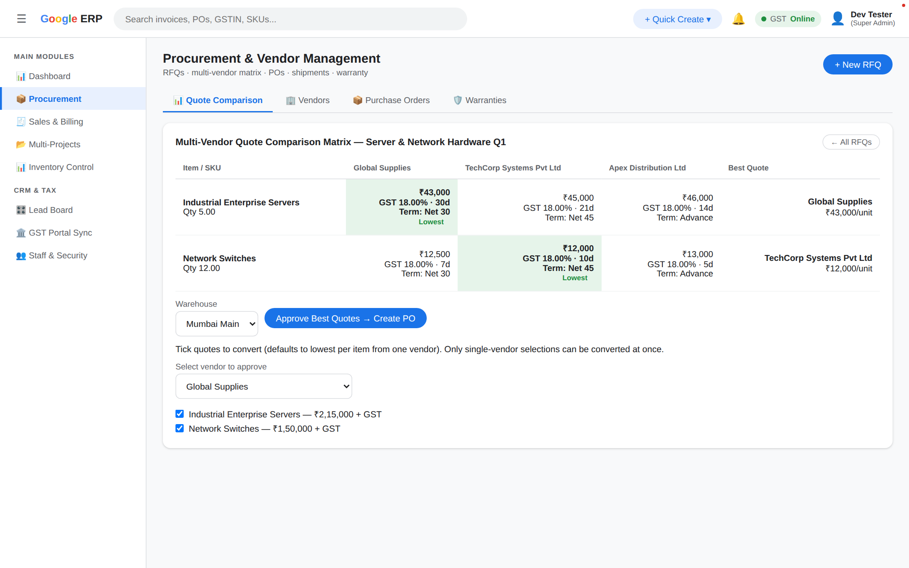 |

| Purchase Orders & Shipment Tracking | Warranty & Serial Register |
|---|---|
| 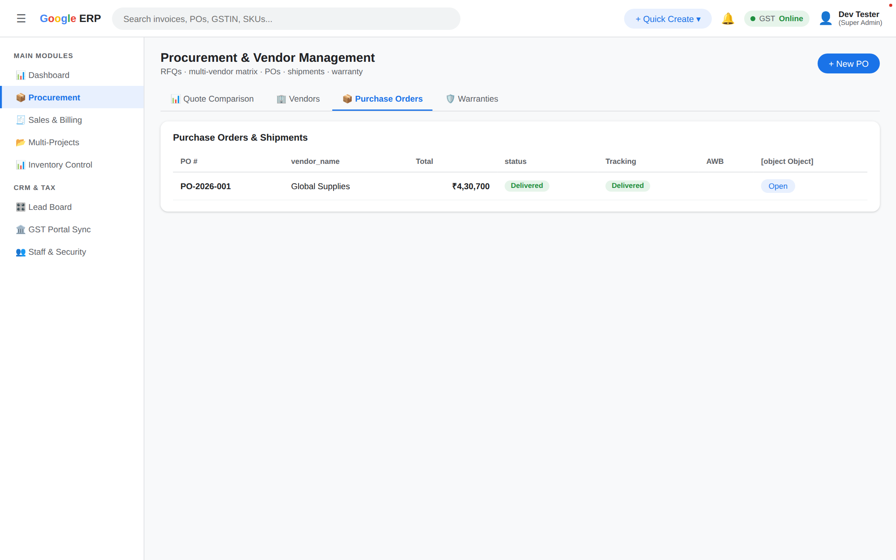 | 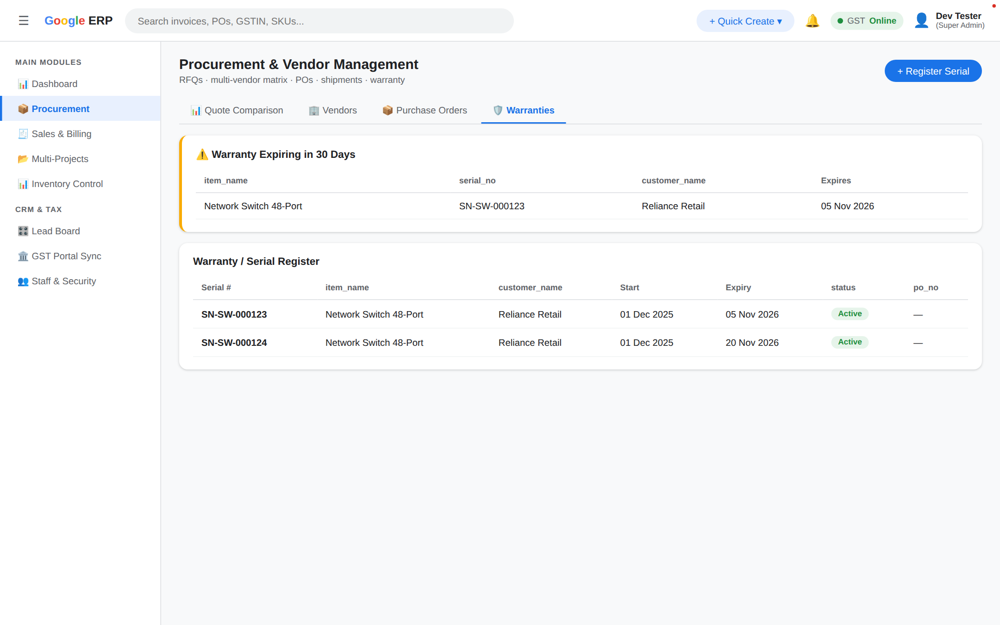 |

### 🧾 Sales & Billing
| Outward Document Billing Engine |
|---|
| 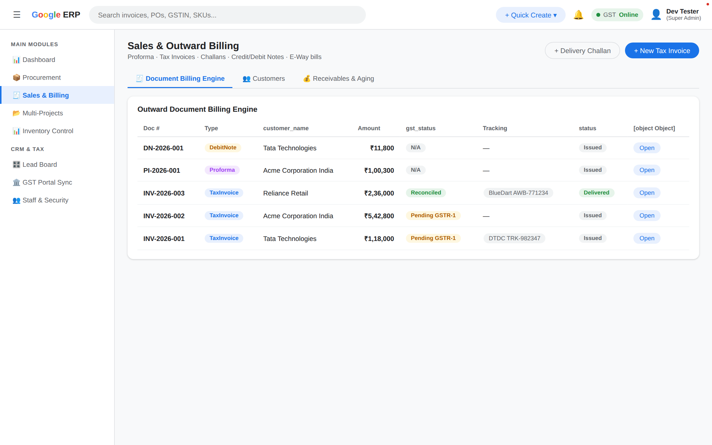 |

| Customer Directory | Receivables & Aging (30/60/90) |
|---|---|
| 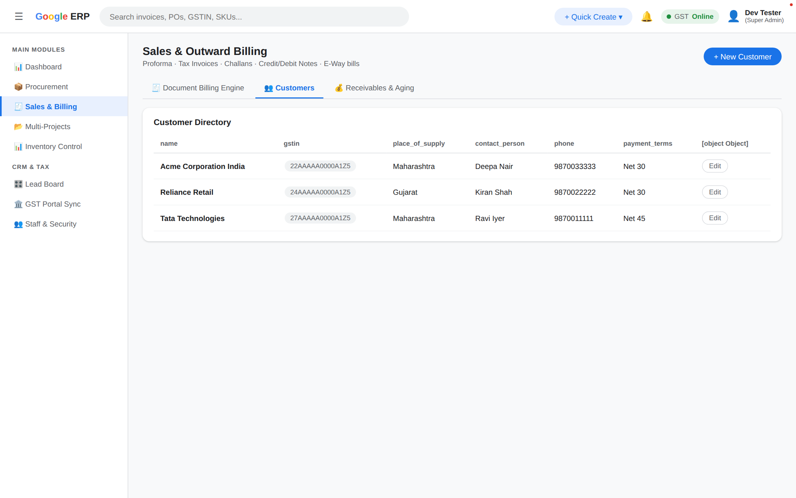 | 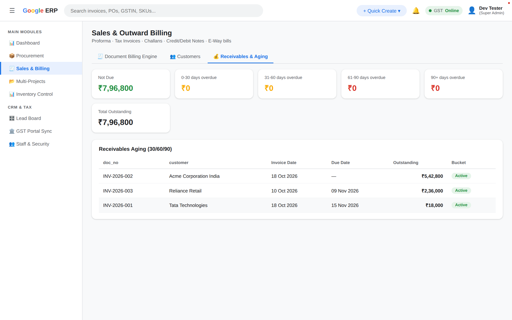 |

### 📊 Inventory Control
| Stock by Warehouse & SKU Lookup | Item Master & SKUs |
|---|---|
| 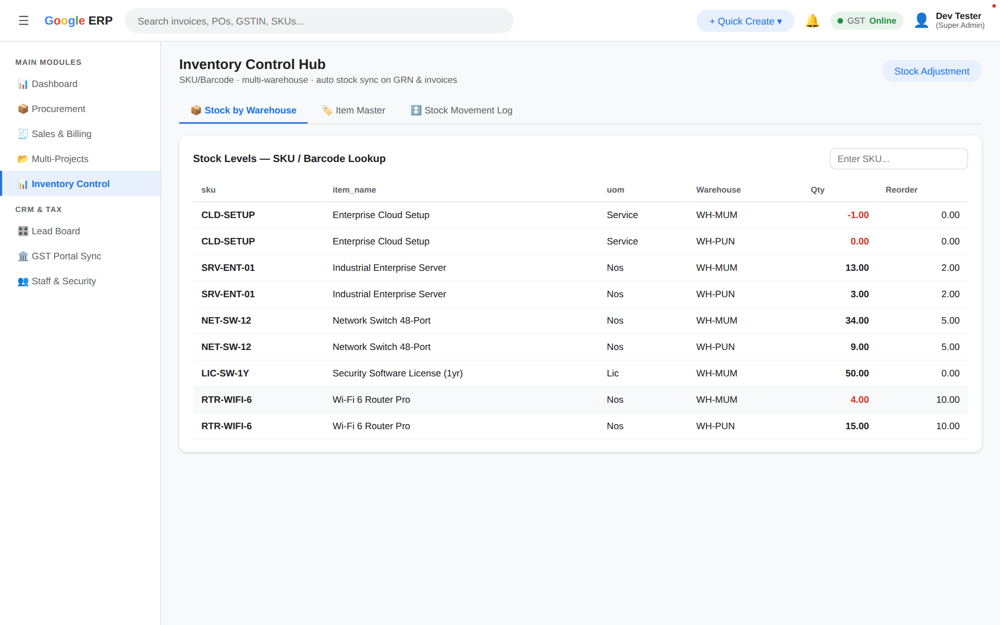 | 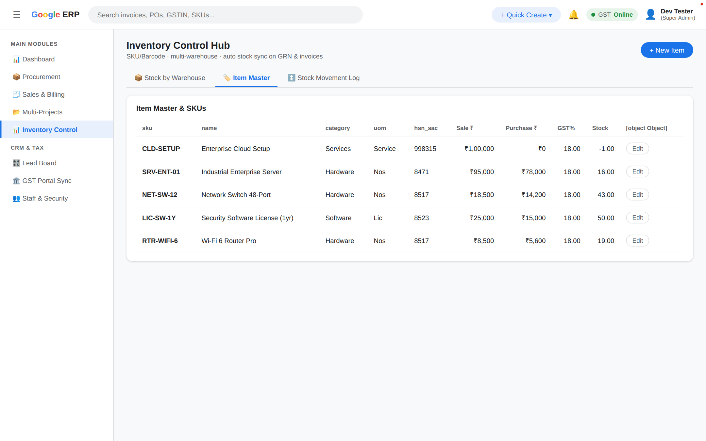 |

### 🎛️ CRM Lead Tracker (Kanban)
| Drag-and-Drop Pipeline |
|---|
| 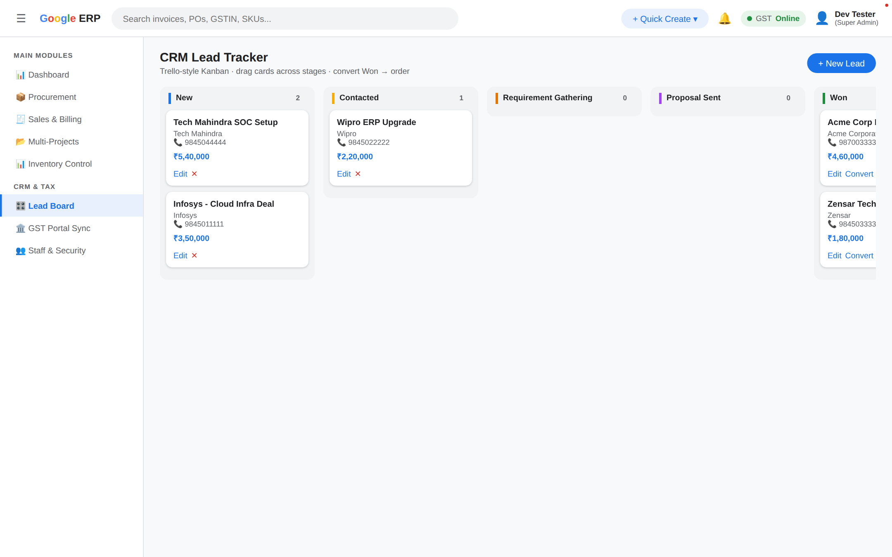 |

### 📂 Multi-Project Cost Mapping
| Project Profitability |
|---|
| 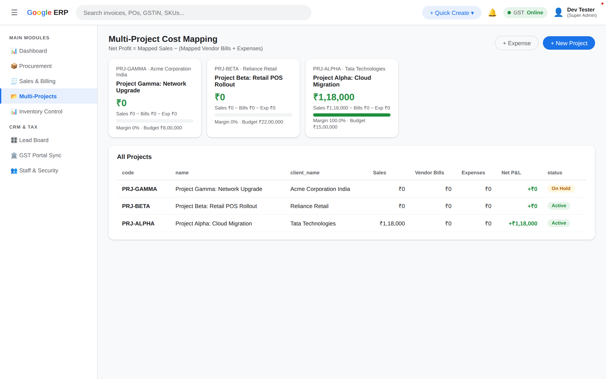 |

### 🏛️ GST Portal Sync
| GSTR-2B Reconciliation & Filing Center |
|---|
| 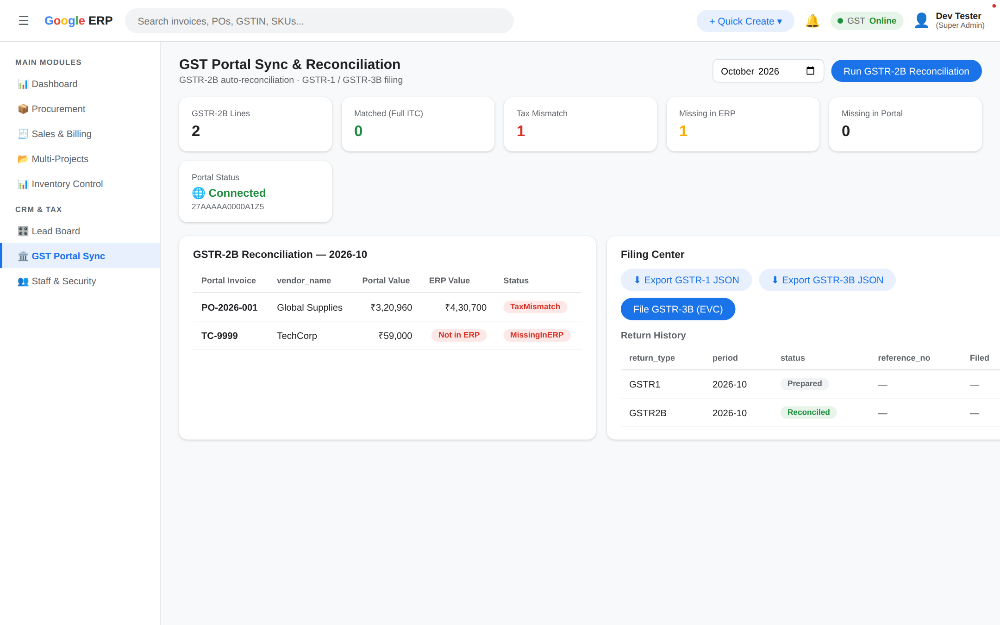 |

### 👥 Staff & Security
| Roles & Granular Permissions | Audit Trail |
|---|---|
| 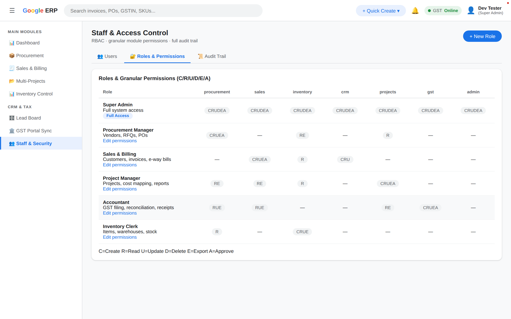 | 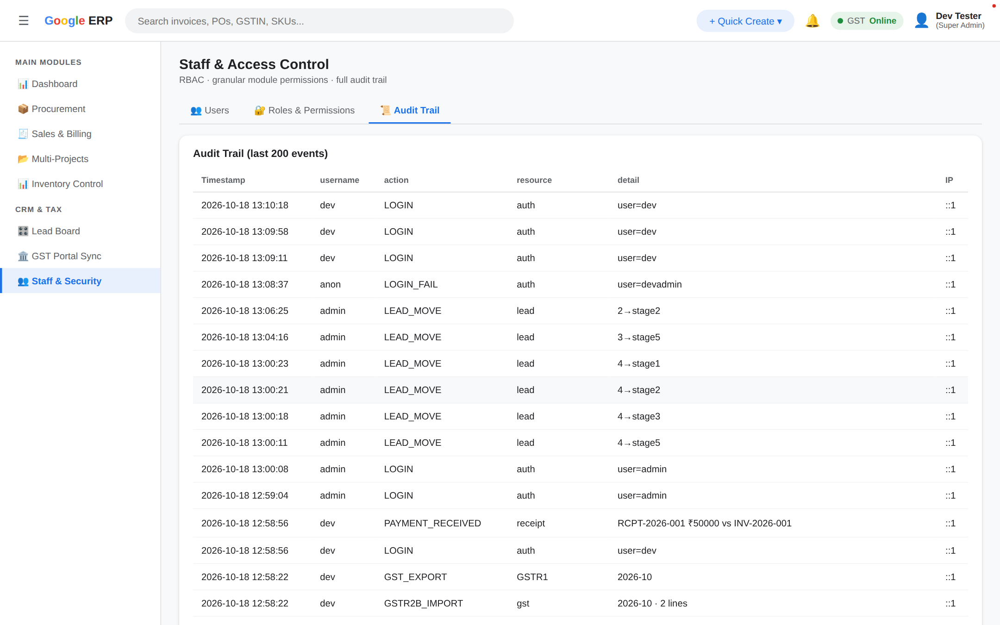 |

### 📱 Responsive (Mobile)
| Dashboard (390px) | Navigation Drawer |
|---|---|
| 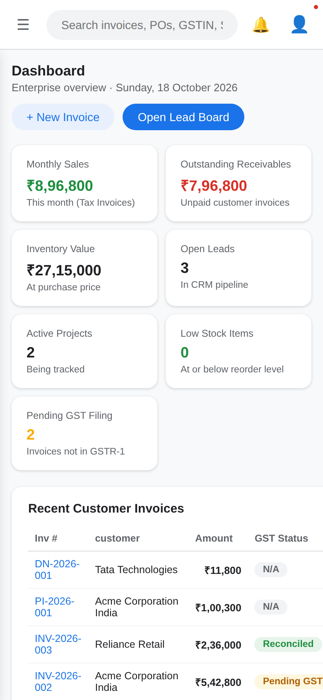 | 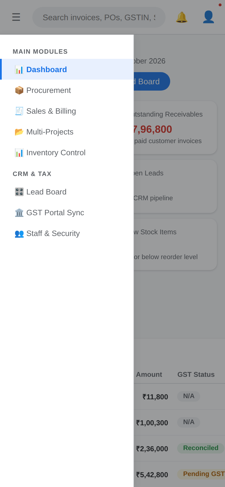 |

---

## 🛠️ Tech Stack

| Layer | Technology |
|---|---|
| **Frontend** | Vanilla JS SPA (hash router), HTML5, hand-written CSS (Material 3 / X3M Admin theme) — **no build step** |
| **Backend** | Node.js, Express 5 |
| **Database** | MariaDB / MySQL 8 (via `mysql2` connection pool) |
| **Auth** | `express-session` (web) + `jsonwebtoken` Bearer tokens (mobile / MCP / external clients) + `bcryptjs` |
| **AI / MCP** | `@modelcontextprotocol/sdk` — stdio + streamable-HTTP transports |
| **Mobile** | Flutter (`mobile/`) — Android & iOS |
| **Config** | `dotenv` |
| **Screenshots** | `puppeteer-core` + system Chrome (dev tool) |

---

## 📁 Project Structure

```
ERP/
├── server.js                    # Express app entry — mounts routes & static SPA
├── package.json
├── .env.example                 # Environment template
├── scripts/
│   ├── init-db.sh               # Bootstraps a dedicated MariaDB instance + DB/user
│   └── screenshots.js           # Auto-captures module screenshots
├── server/
│   ├── db/
│   │   ├── schema.sql           # Full relational schema (all modules)
│   │   ├── seed.sql             # Demo data (vendors, customers, items, leads, quotes)
│   │   └── pool.js              # mysql2 connection pool
│   ├── docs/
│   │   ├── index.html           # Web-hosted API + MCP documentation (/docs)
│   │   └── openapi.json         # OpenAPI 3.1 spec (/api/docs/openapi.json)
│   ├── lib/
│   │   ├── middleware.js        # Auth guards (session + Bearer JWT), RBAC, audit logging
│   │   ├── tokens.js            # JWT access/refresh token helpers
│   │   └── tenant.js            # Host/subdomain → tenant resolution
│   └── routes/
│       ├── auth.js              # Login / logout / change-password / token exchange
│       ├── company.js           # Company profile API (mobile & external clients)
│       ├── mcp.js               # Streamable-HTTP MCP endpoint (/api/mcp)
│       ├── docs.js              # API documentation routes
│       ├── vendors.js  rfqs.js  pos.js  warranties.js
│       ├── customers.js  salesdocs.js  receipts.js
│       ├── items.js  warehouses.js  stock.js
│       ├── leads.js  projects.js  expenses.js
│       ├── gst.js  staff.js  search.js  notifications.js
├── mcp/
│   ├── server.js                # MCP tool definitions (company, sales, CRM, inventory…)
│   └── stdio.js                 # stdio transport entry (npm run mcp)
├── mobile/                      # Flutter app (login, dashboard, company, customers, items)
│   ├── pubspec.yaml
│   └── lib/
│       ├── main.dart  api_client.dart
│       └── screens/             # login, home, dashboard, company, customers, items
├── public/
│   ├── index.html               # App shell (login, top bar, drawer)
│   ├── css/app.css              # Responsive Material 3 theme
│   └── js/
│       ├── app.js               # Auth flow, router, shell wiring
│       ├── ui.js                # Shared UI helpers (helpers, tables, modals)
│       └── views/               # One file per module (dashboard, procurement, ...)
└── screenshots/                 # README screenshots
```

---

## 🚀 Getting Started (Local Development)

### Prerequisites
- **Node.js** 18+
- **MariaDB** or **MySQL 8** (or let `scripts/init-db.sh` spin up a local instance)

### 1. Clone & install
```bash
git clone https://github.com/indianprogrammer/ERP.git
cd ERP
npm install
```

### 2. Configure environment
```bash
cp .env.example .env
# edit .env  (DB credentials, SESSION_SECRET, JWT_SECRET, PORT)
```

### 3. Create the database & schema
Option A — use the bundled bootstrap (spins up a dedicated MariaDB on port **3307**, no root required):
```bash
npm run dbinit
mysql --socket=/tmp/erp-mysql.sock -uroot erp < server/db/schema.sql
mysql --socket=/tmp/erp-mysql.sock -uroot erp < server/db/seed.sql
```

Option B — use your own MySQL/MariaDB instance:
```sql
CREATE DATABASE erp CHARACTER SET utf8mb4 COLLATE utf8mb4_unicode_ci;
CREATE USER 'erp'@'127.0.0.1' IDENTIFIED BY 'your_password';
GRANT ALL PRIVILEGES ON erp.* TO 'erp'@'127.0.0.1';
```
Then load `server/db/schema.sql` and `server/db/seed.sql`.

### 4. Run
```bash
npm start
# → http://localhost:3000
```

### Default credentials
| Username | Password | Role | Notes |
|---|---|---|---|
| `admin` | `admin` | Super Admin | **Must change password on first login** |
| `sales` | `staff123` | Sales & Billing | Demo staff account |
| `purchase` | `staff123` | Procurement Manager | Demo staff account |

---

## 🌐 Deployment

### Option 1 — Single VPS / Linux server (recommended)

**1. Install runtime & database**
```bash
# Node 20 (via nvm or nodesource)
curl -fsSL https://deb.nodesource.com/setup_20.x | sudo -E bash -
sudo apt-get install -y nodejs mariadb-server nginx
```

**2. Create database & user**
```bash
sudo mysql -e "CREATE DATABASE erp CHARACTER SET utf8mb4 COLLATE utf8mb4_unicode_ci;"
sudo mysql -e "CREATE USER 'erp'@'localhost' IDENTIFIED BY 'STRONG_PASSWORD'; GRANT ALL ON erp.* TO 'erp'@'localhost';"
sudo mysql erp < server/db/schema.sql
sudo mysql erp < server/db/seed.sql      # optional demo data
```

**3. Configure production `.env`**
```env
DB_HOST=127.0.0.1
DB_PORT=3306
DB_USER=erp
DB_PASSWORD=STRONG_PASSWORD
DB_NAME=erp
SESSION_SECRET=<output of: openssl rand -hex 32>
NODE_ENV=production
PORT=3000
```

**4. Run under a process manager (PM2)**
```bash
sudo npm i -g pm2
pm2 start server.js --name erp
pm2 startup && pm2 save          # auto-start on boot
```

**5. Nginx reverse proxy + HTTPS**
```nginx
server {
    listen 80;
    server_name erp.example.com;

    location / {
        proxy_pass         http://127.0.0.1:3000;
        proxy_http_version 1.1;
        proxy_set_header   Upgrade $http_upgrade;
        proxy_set_header   Connection 'upgrade';
        proxy_set_header   Host $host;
        proxy_set_header   X-Real-IP $remote_addr;
        proxy_set_header   X-Forwarded-For $proxy_add_x_forwarded_for;
        proxy_set_header   X-Forwarded-Proto $scheme;
        proxy_cache_bypass $http_upgrade;
    }
}
```
```bash
sudo ln -s /etc/nginx/sites-available/erp /etc/nginx/sites-enabled/
sudo nginx -t && sudo systemctl reload nginx
sudo certbot --nginx -d erp.example.com     # free TLS (Let's Encrypt)
```

> **Production checklist:** set a strong `SESSION_SECRET`, enable TLS (TLS 1.3), keep `app.set('trust proxy', 1)` when behind a proxy, enable MySQL encryption/persistent storage, and schedule `mysqldump` backups.

### Option 2 — Docker

`Dockerfile`
```dockerfile
FROM node:20-alpine
WORKDIR /app
COPY package*.json ./
RUN npm ci --omit=dev
COPY . .
ENV NODE_ENV=production PORT=3000
EXPOSE 3000
CMD ["node", "server.js"]
```

`docker-compose.yml`
```yaml
services:
  db:
    image: mariadb:10.11
    environment:
      MARIADB_ROOT_PASSWORD: rootpass
      MARIADB_DATABASE: erp
      MARIADB_USER: erp
      MARIADB_PASSWORD: erp_pass
    volumes:
      - dbdata:/var/lib/mysql
      - ./server/db/schema.sql:/docker-entrypoint-initdb.d/1-schema.sql
      - ./server/db/seed.sql:/docker-entrypoint-initdb.d/2-seed.sql
    healthcheck:
      test: ["CMD", "healthcheck.sh", "--connect"]
      interval: 10s
      retries: 5
  app:
    build: .
    environment:
      DB_HOST: db
      DB_PORT: 3306
      DB_USER: erp
      DB_PASSWORD: erp_pass
      DB_NAME: erp
      SESSION_SECRET: change-me
      PORT: 3000
    ports:
      - "3000:3000"
    depends_on:
      db:
        condition: service_healthy
volumes:
  dbdata:
```

```bash
docker compose up -d --build      # → http://localhost:3000
```

### Option 3 — Managed PaaS (Render / Railway / Fly.io)
1. Provision a managed **MySQL** add-on; copy its connection details.
2. Create a **Web Service** from this repo:
   - Build: `npm install`
   - Start: `npm start`
3. Add environment variables from `.env.example` (pointing at the managed DB).
4. Load `schema.sql` (and optionally `seed.sql`) via the provider's SQL console.
5. Set the health/port to `$PORT` (the app already reads `process.env.PORT`).

---

## 🔌 API Reference

Interactive documentation is served by the app itself:

- **HTML docs:** `GET /docs` (or `/api/docs`) — browsable endpoint reference + MCP guide
- **OpenAPI 3.1 spec:** `GET /api/docs/openapi.json`

### Authentication (tokens for mobile / MCP / external clients)

The web UI uses session cookies. External clients (mobile app, MCP server, scripts) use **Bearer JWTs**:

```bash
# 1. Exchange credentials for tokens (tenant users only — super-admin accounts cannot get tokens)
curl -X POST http://localhost:3000/api/auth/token \
  -H 'Content-Type: application/json' \
  -d '{"username":"admin","password":"changeme123","tenantSlug":"acme"}'
# → { "token": "...", "refreshToken": "...", "expiresIn": "7d", "user": {...}, "tenant": {...} }

# 2. Call any tenant API with the token
curl http://localhost:3000/api/company -H 'Authorization: Bearer <token>'

# 3. Rotate tokens before expiry
curl -X POST http://localhost:3000/api/auth/token/refresh \
  -H 'Content-Type: application/json' -d '{"refreshToken":"<refreshToken>"}'
```

Every token is bound to **one company**; all queries are tenant-scoped and RBAC-enforced. Configure `JWT_SECRET`, `JWT_ACCESS_TTL`, `JWT_REFRESH_TTL` in `.env`.

### Company API

| Method | Endpoint | Description |
|---|---|---|
| `GET` | `/api/company` | Company profile + invoice/billing settings |
| `PUT` | `/api/company` | Update own profile (name, GSTIN, address, slug, bank/UPI, themes…; admin perm) |
| `GET` | `/api/company/team` | Company user directory |

### All endpoints

| Method | Endpoint | Description |
|---|---|---|
| `POST` | `/api/auth/login` · `/api/auth/token` | Session login / JWT token exchange |
| `POST` | `/api/auth/token/refresh` · `/api/auth/change-password` | Token rotation / password change |
| `GET` | `/api/dashboard` | Dashboard metrics |
| `GET` | `/api/company` · `PUT` · `/api/company/team` | Company profile & team |
| `GET` | `/api/search?q=` | Global search (invoices, POs, GSTINs, SKUs, projects) |
| `GET/POST` | `/api/vendors` | Vendor directory |
| `GET` | `/api/rfqs/:id/matrix` | Multi-vendor quote comparison |
| `POST` | `/api/rfqs/:id/convert` | Convert winning quotes → PO |
| `GET/POST` | `/api/pos` · `/api/pos/:id/receive` | POs & GRN |
| `GET/POST` | `/api/customers` · `/api/salesdocs` | Customers & outward documents |
| `GET` | `/api/salesdocs/:id/eway-json` | E-Way Bill JSON (Rule 138) |
| `GET` | `/api/salesdocs/aging` | Receivables aging (30/60/90) |
| `GET/POST` | `/api/items` · `/api/stock` · `/api/warehouses` | Inventory |
| `GET/POST` | `/api/leads` · `/api/leads/:id/move` · `/api/leads/:id/convert` | CRM Kanban |
| `GET/POST` | `/api/projects` · `/api/projects/:id/link` | Project cost mapping |
| `GET/POST/DELETE` | `/api/expenses` · `/api/expenses/:id` | Expenses — **project-based** (`project_id`) or **individual** (omit `project_id`); filter `?type=project|individual&month=YYYY-MM&q=` |
| `POST` | `/api/gst/gstr2b/import` · `/api/gst/gstr2b/reconcile` | GSTR-2B reconciliation |
| `GET` | `/api/gst/:type/export` · `POST /api/gst/:type/file` | GSTR-1/3B export & filing |
| `GET/POST` | `/api/staff/users` · `/api/staff/roles` · `/api/staff/audit` | RBAC & audit |
| `POST` | `/api/mcp` | MCP endpoint (JSON-RPC, see below) |

> All `/api/*` routes (except `auth` and `docs`) require a session cookie **or** `Authorization: Bearer <token>` and are enforced by module-level RBAC middleware.

---

## 🤖 MCP Server (AI agents)

Expose the ERP to AI agents (Claude Desktop, Claude Code, or any MCP client) with two transports and the same tools. Tools call the REST API with your token, so company RBAC always applies. **No super-admin access — tenant company scope only.**

**Tools:** `company_get` · `company_update` · `dashboard_get` · `customers_list` · `customer_create` · `items_list` · `item_create` · `stock_low` · `vendors_list` · `vendor_create` · `sales_documents_list` · `leads_list` · `lead_create` · `expenses_list` · `expense_create`

### Option A — Streamable HTTP (remote / hosted agents)

The Express server exposes a stateless MCP endpoint at **`POST /api/mcp`**:

```json
{
  "mcpServers": {
    "x3m-erp": {
      "type": "streamable-http",
      "url": "http://localhost:3000/api/mcp",
      "headers": { "Authorization": "Bearer <token from /api/auth/token>" }
    }
  }
}
```

### Option B — stdio (local agent subprocess)

```bash
npm run mcp   # runs mcp/stdio.js
```

```json
{
  "mcpServers": {
    "x3m-erp": {
      "command": "node",
      "args": ["/path/to/ERP/mcp/stdio.js"],
      "env": {
        "ERP_API_URL": "http://localhost:3000",
        "ERP_TENANT": "acme",
        "ERP_USERNAME": "admin",
        "ERP_PASSWORD": "changeme123"
      }
    }
  }
}
```

(`ERP_TOKEN` can be set instead of username/password to skip the credential exchange.)

---

## 📱 Mobile App (Flutter)

A Flutter app lives in [`mobile/`](mobile/): login via `/api/auth/token`, then dashboard KPIs, company profile editing, customers, inventory items, and expenses (project-based or individual).

```bash
cd mobile
flutter create --platforms=android,ios .   # generate platform folders (first time only)
flutter pub get
flutter run                                 # Android emulator hits http://10.0.2.2:3000
```

The server URL is configurable on the login screen (Server settings). Use your machine's LAN IP for a physical device.

---

## ⚠️ Notes & Limitations
- The **GSTN / GSP integration is simulated** (import/export JSON + EVC acknowledgement). Wiring to a live GSP/ASP requires GSTN API credentials and a registered DSC.
- **E-invoicing (IRN)** generation is not included; **E-Way Bill JSON** export is.
- No automated test suite yet.
- GST is computed as **CGST/SGST/IGST** (UTGST not separated).
- Quick-access: **Quick Create** menu, **`➕`** actions on every module, and click-anywhere global search.

---

## 📄 License

Released under the **MIT License**. See `LICENSE` for details.

<div align="center"><sub>Built with ❤️ for Indian businesses · X3M Admin ERP Suite v3.4</sub></div>
